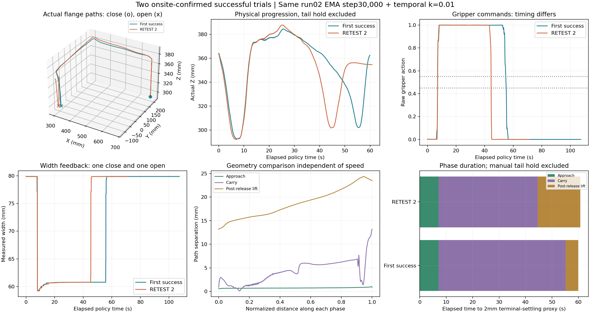

# Franka 单机械臂 ACT 抓放复现

本仓库整理了 **2026-11-12 两轮实机成功**使用的代码：Franka FR3、平行夹爪、头部与腕部双相机，使用14段示教训练的 **run02 EMA，第30,000步**，部署采用原生 **0.01时间融合**。

源码从已验证快照逐字节收录。原实机执行器、FK、相机预处理和控制通信代码未在本次发布中修改。代码归档于2026-11-16；本次整理没有启动相机或机械臂。

## 先运行离线检查

```bash
git clone https://github.com/YINJIAJU1123/franka.git
cd franka
python tools/verify_repository.py
python -m unittest discover -s tests -v
```

这些检查只依赖Python标准库，不创建ROS节点或硬件连接。GitHub Actions执行相同的离线检查。

## 已验证的结果

| 指标 | 首轮成功 | RETEST 2 |
|---|---:|---:|
| 现场确认 | 完整抓放完成 | 完整抓放完成 |
| 闭合指令时刻 | 7.137 s | 7.081 s |
| 松开指令时刻 | 55.092 s | 44.557 s |
| 夹持宽度中位数 | 60.765 mm | 60.741 mm |
| 策略频率 | 29.882 Hz | 29.888 Hz |
| 程序退出 | C，退出码0 | C，退出码0 |

两轮接近路径差异P95约0.87mm；松开位置相差13.20mm，最终末端位置相差22.08mm。两次任务成功不代表位置、时序完全一致或已建立泛化成功率。位置来自同一URDF的`fr3_link8`，不是方块落点测量。



## 成功经验

1. **保留3万步EMA和原生0.01时间融合。** 同记录观测的离线比较中，目标残差抖动指标降低约64%，实机随后完成两轮任务。
2. **匹配ACT的微小修正。** 使用原笛卡尔控制器的ACT参数副本，仅线速度和角速度死区置0，其他控制限制保留。
3. **检查七关节起点和首预测。** SpaceMouse将末端回到附近时，q6仍可能偏4.75°。七关节回位后，首预测偏差由约41mm降至5.2mm。
4. **固定输入及校准。** 保留双相机身份与预处理、真实关节反馈、夹爪状态屏蔽、宽度标签校准和10帧训练提前量。
5. **固定成功基线再复验。** 时间融合改善连续性，验证段的多关节目标偏差仍存在；没有加入固定坐标或q3输入补偿。

## 代码索引

| 路径 | 作用 |
|---|---|
| [runtime_lixin/original_runner.py](runtime_lixin/original_runner.py) | 成功实机主循环、B/C交互、断流检查和夹爪滞回 |
| [runtime_lixin/runtime_config.json](runtime_lixin/runtime_config.json) | 成功配置：0.01融合、100帧动作块、每次感知更新 |
| [runtime_lixin/run_real.sh](runtime_lixin/run_real.sh) | 原实机启动入口，默认只检查 |
| [runtime_lixin/lerobot/src/lerobot/policies/act/modeling_act.py](runtime_lixin/lerobot/src/lerobot/policies/act/modeling_act.py) | 原生`ACTTemporalEnsembler`及动作块 |
| [runtime_lixin/franka_gripper_control.py](runtime_lixin/franka_gripper_control.py) | 关节目标FK与有界笛卡尔增量 |
| [runtime_lixin/franka_gripper_transport.py](runtime_lixin/franka_gripper_transport.py) | 双相机/状态接收和`<7f>` UDP发送 |
| [yin_controller/act_control_profile](yin_controller/act_control_profile) | 实际使用的Yin控制参数与launch |
| [yin_controller/ros2_src](yin_controller/ros2_src) | 原ROS2控制器和状态发送源码 |
| [state_receiver_source/deployment](state_receiver_source/deployment) | 校准后的FRST v2状态接收器 |
| [camera_source](camera_source) | 实际相机启动与处理脚本 |
| [training_reference](training_reference) | run02训练入口、配置与训练日志 |
| [analysis_tools](analysis_tools) | 两轮日志对比及位置偏差定位代码 |
| [yin_controller/return_to_success_start](yin_controller/return_to_success_start) | 单次回位源码、标准运动生成器及验证摘要 |

## 模型、数据与部署范围

成功EMA约207MB，**不放入普通Git**。模型身份、SHA256及恢复方法见 [模型与外部资产](docs/MODEL_AND_ASSETS.md)。原始视频、轨迹CSV、输入图像夹具、Parquet和缓存也不随源代码发布，汇总指标及轨迹图保留在`evidence/`。

本仓库保留了成功现场的绝对路径及原校验清单。使用现有Linux部署时，实机入口为：

```text
/home/lixin/act_gripper_temporal_run02_20261112/run_real.sh
```

ROS/Conda、libfranka共享库、完整上游ROS工作区和原始数据是外部依赖。新克隆不会自动成为可运行的实机部署；迁移前需按 [双主机复现步骤](docs/REPRODUCTION.md) 核对路径、资产、环境和离线检查。GitHub CI通过也不等同于硬件验证。

## 来源与完整性

- [reproduction_manifest.json](reproduction_manifest.json)：逐文件来源及成功代码SHA256。
- [external_assets_manifest.json](external_assets_manifest.json)：未入Git的模型、夹具、轨迹及其校验值。
- [environment/verified_versions.json](environment/verified_versions.json)：现场Python/ROS/SDK版本记录。
- [第三方许可说明](THIRD_PARTY_NOTICES.md)：保留的上游许可及源码范围。

回位工具绑定当次预期起点，不能删掉检查后当作通用回位程序。当前成功配置、已知误差和使用边界均在复现文档中说明。
